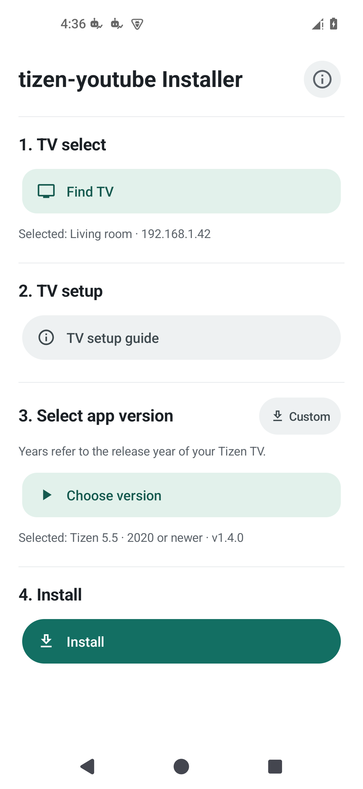

# tizen-youtube-installer

Install [tizen-youtube](https://github.com/SushyDev/tizen-youtube) on your Samsung TV from your Android phone. No PC or Termux needed.

**[Download APK](https://github.com/Readiz/tizen-youtube-installer/releases/latest)** · Android 8.0+ · English

## Get started

Connect your phone and TV to the same Wi-Fi.

1. **TV select** — tap **Find TV** and choose your TV.
2. **TV setup** — follow the in-app guide to enable Developer Mode and enter your phone’s IP.
3. **Select app version** — tap **Choose version**. The years shown refer to the TV’s release year.
4. **Install** — check the selected file and TV, then confirm. A Samsung account may be required.

**Custom** supports other GitHub repositories and local WGT files. See the [usage guide](docs/USAGE.md) for TV setup, manual IP entry and custom installs.

Keep this installer and its data: they contain the signing keys needed for future updates. Compatibility depends on your TV and the selected app.

## More

[Usage](docs/USAGE.md) · [Build](docs/BUILDING.md) · [Architecture](docs/ARCHITECTURE.md) · [Security](docs/SECURITY.md) · [Test results](docs/TEST_REPORT.md)

Built on work by SushyDev and reisxd, with Apps2Samsung as related Android prior work. [Credits](docs/CREDITS.md) · [License details](docs/LICENSING.md)

[GPL-3.0-only](LICENSE) · Unofficial; not affiliated with Samsung, Google or YouTube.
